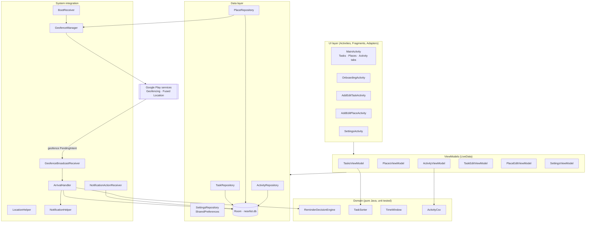
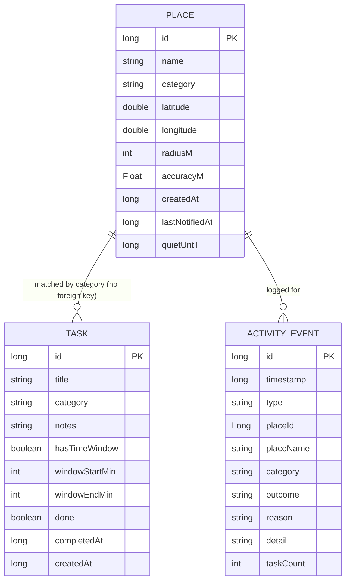
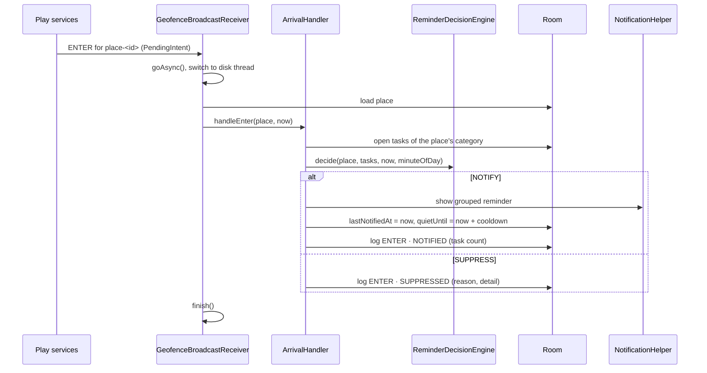

# Nearlist

Nearlist is an Android to-do app that reminds you about tasks **when you arrive at a place where you can do them**.

You don't attach a task to a single address. You tag it with a **category** (Grocery, Fuel, Pharmacy or Other) and save the places you actually visit under those categories. When you walk into *any* saved place of a task's category, Nearlist shows one grouped reminder with every open task for that category.

Every arrival, departure and suppressed reminder is written to an **Activity log** with the reason, so you can always see why a reminder did or didn't appear.

- 100% offline. No account, no server, no network code. All data stays on the device.
- No maps. A place is captured from your current GPS position, or from coordinates you type in.
- Battery-aware geofencing through Google Play services.

---

## Contents

1. [Features](#features)
2. [Download](#download)
3. [Requirements](#requirements)
4. [Setup](#setup)
5. [Build and run](#build-and-run)
6. [Testing on the emulator](#testing-on-the-emulator)
7. [User guide](#user-guide)
8. [Debug tools](#debug-tools)
9. [Architecture](#architecture)
10. [Project structure](#project-structure)
11. [Data model](#data-model)
12. [How a reminder is decided](#how-a-reminder-is-decided)
13. [Geofence registration](#geofence-registration)
14. [Permissions](#permissions)
15. [Tests](#tests)
16. [Known limitations](#known-limitations)
17. [Changelog](#changelog)
18. [Open-source licences](#open-source-licences)

---

## Features

| Feature | What it does |
|---|---|
| Category-based reminders | A task is reminded at **any** saved place of its category, not at one fixed address. |
| Grouped notification | One notification per place lists every open task for that category, with **Mark done** / **Mark all done** and **Snooze 1 h** actions. |
| Per-place cooldown | After a reminder at a place, that place stays quiet for 1, 4 (default), 8 or 24 hours. |
| Time windows | A task can be limited to hours such as 6–9 PM. Windows may cross midnight (10 PM–2 AM). |
| Nearest-first task list | With a location fix, tasks are sorted by distance to the nearest place of their category. |
| Activity log | Every ENTER / EXIT / SYSTEM event, with the outcome and the reason (cooldown, outside time window, no open tasks, notifications blocked). Filter by outcome and export as CSV. |
| Battery-saver awareness | Below 20 % battery and not charging, geofence responsiveness drops from 1 min to 5 min. |
| Demo mode | Cooldown of 10 s and instant geofence responsiveness for live demonstrations. Switches itself off after 1 hour. |
| Self-healing | Zones are re-registered after a reboot, an app update and on app open (see [Geofence registration](#geofence-registration)). |

---

## Download

| Item | Value |
|---|---|
| Release | [v1.0.1](https://github.com/Krisantha-VS/NearList/releases/tag/v1.0.1) |
| File | `Nearlist-v1.0.1-release.apk` |
| SHA-256 | `599808297ac7e2ef7ee2089dd4e66135037a07936ef2d03bef0cf9c184148a59` |
| Requires | Android 7.0 (API 24) or later |

Verify the download before installing:

```powershell
Get-FileHash .\Nearlist-v1.0.1-release.apk -Algorithm SHA256   # Windows
```

```bash
sha256sum Nearlist-v1.0.1-release.apk                          # macOS/Linux
```

The hash must match the value above. See [Release APK](#release-apk) for how to install it.

---

## Requirements

| Item | Version |
|---|---|
| Android Studio | **Panda 4 (2025.3.4) or later**, required by AGP 9.2.1 (developed and verified on Rabbit 1, 2026.2.1) |
| JDK | 21 for the Gradle daemon toolchain (`gradle/gradle-daemon-jvm.properties`) |
| Android Gradle Plugin | 9.2.1 |
| Gradle | 9.4.1 (wrapper included) |
| compileSdk / targetSdk | 36.1 / 36 |
| minSdk | 24 (Android 7.0). Play services Location 21.3.0 (geofencing) requires API 21+ and the Java 8 APIs used require API 24, which reaches about 96.6% of active devices. |
| Language | Java 11 source compatibility |
| Device / emulator | **Must include Google Play services** (use a "Google APIs" or "Google Play" system image) |

Main libraries (see `gradle/libs.versions.toml`):

- Material Components 1.12.0 (Material 3, `Theme.Material3.DayNight.NoActionBar`)
- Room 2.6.1 (with `annotationProcessor`)
- Lifecycle ViewModel / LiveData 2.8.7
- Play services Location 21.3.0 (Fused Location Provider and Geofencing)
- RecyclerView 1.3.2, ViewPager2 1.1.0, ConstraintLayout 2.1.4, AppCompat 1.6.1

Deliberately **not** used: Jetpack Compose, the Navigation component, Hilt/Dagger, RxJava, Kotlin coroutines, the Maps SDK and any network library.

---

## Setup

1. **Get the project.** Clone or copy the `Nearlist` folder to your machine.
2. **Open it in Android Studio.** Use *File › Open* and select the `Nearlist` folder (the one containing `settings.gradle.kts`). Let Gradle sync finish.
3. **Check the SDK.** Install Android SDK Platform 36.1 and the latest build tools in *Settings › Languages & Frameworks › Android SDK*. `local.properties` is created by Android Studio and points to your SDK.
4. **Create an emulator with Google Play services.** In *Device Manager*, create a device such as a Pixel with a **Google APIs** or **Google Play** image (API 33 or later is recommended so the notification permission flow is shown). Geofencing does not work on plain AOSP images.
5. **Run the app.** Select the `app` configuration and press *Run*.

### Command line

The Gradle wrapper works without Android Studio open. On Windows, point `JAVA_HOME` at Android Studio's bundled runtime:

```powershell
$env:JAVA_HOME = "C:\Program Files\Android\Android Studio\jbr"
.\gradlew.bat assembleDebug               # build the debug APK
.\gradlew.bat installDebug                # install the debug build on the running emulator/device
.\gradlew.bat testDebugUnitTest           # JVM unit tests
.\gradlew.bat connectedDebugAndroidTest   # instrumented + Espresso tests (needs an emulator/device)
.\gradlew.bat lintDebug                   # Android lint
.\gradlew.bat assembleRelease             # minified release APK (signed if keystore.properties exists)
```

On macOS/Linux use `./gradlew` with the same task names. If `local.properties` is missing (it is not in git), create it with `sdk.dir=C:\\Users\\<you>\\AppData\\Local\\Android\\Sdk`, or open the project once in Android Studio. The first build downloads Android SDK Platform 36.1 if it is not installed.

| Output | Path |
|---|---|
| Debug APK | `app/build/outputs/apk/debug/app-debug.apk` |
| Release APK | `app/build/outputs/apk/release/app-release.apk` (`app-release-unsigned.apk` without signing) |
| Unit test report | `app/build/reports/tests/testDebugUnitTest/index.html` |
| Instrumented test report | `app/build/reports/androidTests/connected/debug/index.html` |

---

## Build and run

| Build type | Notes |
|---|---|
| `debug` | Includes the developer menu items on the Tasks tab (see [Debug tools](#debug-tools)). |
| `release` | Debug menu items are hidden (`BuildConfig.DEBUG` is false). R8 minification and resource shrinking are on (`app/proguard-rules.pro`). |

On first launch the app opens **onboarding**, which asks for the permissions it needs, then shows the main screen.

### Debug run

In Android Studio select the `app` configuration and press *Run*, or from the command line start an emulator with Google Play services and run `.\gradlew.bat installDebug`, then open Nearlist from the launcher.

### Release APK

Release signing reads `keystore.properties` in the project root. The file and the keystore are **not** in git. Create your own keystore with `keytool` and the file:

```properties
storeFile=C:/path/to/nearlist-release.jks
storePassword=...
keyAlias=nearlist
keyPassword=...
```

Without `keystore.properties`, `assembleRelease` still works but produces an unsigned APK, which Android will not install until it is signed.

Install a signed release APK:

- **adb:** `adb install Nearlist-v1.0.1-release.apk`. If a debug build is installed, remove it first with `adb uninstall com.sharma.nearlist`, because the two are signed with different keys.
- **Sideloading:** copy the APK to the phone, open it from a file manager and allow *Install unknown apps* for that app when Android asks.

---

## Testing on the emulator

The emulator's location is set with `adb` (note the order: **longitude first, then latitude**):

```powershell
adb emu geo fix 79.9607 6.5854     # Keells Kalutara (sample place)
adb emu geo fix 79.9000 6.5000     # somewhere outside all sample places
```

A typical test run:

1. Open the app and finish onboarding. Choose **Allow all the time** for location, otherwise no zones can be registered.
2. Set the emulator outside the sample places: `adb emu geo fix 79.9000 6.5000`.
3. On the Tasks tab, open the overflow menu (⋮) and choose **Load sample data**.
4. In the same menu, turn on **Keep location active**. The emulator's fused location provider only evaluates geofences while some app is requesting location.
5. Optional: *Settings › Demo mode* for instant responsiveness and a 10-second cooldown.
6. Move into a place: `adb emu geo fix 79.9607 6.5854`. Within about a minute you get a reminder (if a matching task is eligible), and the Activity tab shows an **Entered** row.
7. Move out again to see an **Exited · Logged** row.

Useful Logcat filter: `tag:Nearlist`. It shows every sync (`syncAll: addGeofences succeeded, 3 zones, responsiveness 60000 ms`), every received broadcast (`onReceive … transition=ENTER ids=[place-1]`) and every decision (`ENTER place-1 "Keells Kalutara": SUPPRESSED OUTSIDE_TIME_WINDOW (6–9 PM)`).

If geofence events are slow or don't arrive on the emulator, use **Simulate arrival…** from the debug menu. It runs exactly the same reminder pipeline without Play services.

---

## User guide

### Onboarding

Up to four steps, depending on the Android version:

1. **Welcome.** What Nearlist does.
2. **Location.** Precise location is needed to save places and detect arrivals. If you only allow approximate location, the screen explains how to switch to precise.
3. **Background location** (Android 10+). Choose **Allow all the time**. Without it Android refuses to register geofences, so **reminders can't work at all**, even while the app is open. "Not now" is allowed, but the app will then show a "Reminders are off" banner.
4. **Notifications** (Android 13+). Needed to show reminders.

You can change any of these later from *Settings › Permissions*.

### Tasks tab (home)

- **Status banner** at the top when something stops reminders from working, in this order of priority:
  1. *Location is turned off* → **Turn on**.
  2. *Reminders are off* (no "Allow all the time") → **Fix** opens app settings.
  3. *Notifications are off* → **Fix** opens notification settings.

  The × hides the banner until the app is restarted.
- **Category filter chips:** All, Grocery, Fuel, Pharmacy, Other.
- **Task cards** show the category icon, the title and:
  - "Nearest: <place>" and a distance chip when your location is known ("450 m", "2.4 km", "37 km", or "500+ km" for anything further). The closest task overall has a highlighted chip.
  - A time-window chip (for example "6–9 PM") when the task has one.
  - "No place saved for this category" when no place of that category exists yet.
- Without a location fix the list reads "Oldest first · location unknown".
- **Tick the checkbox** to complete a task. It moves to the collapsible **Completed** section ("Done · 9:42 AM"). Untick it to reopen.
- **Tap a card** to edit the task. **Add task** (bottom right) creates one. It shrinks while you scroll.
- **Empty state:** a two-step guide with **Save a place**, which opens the Places tab.

### Adding or editing a task

1. Enter a **title** (required; Save is disabled while it is empty).
2. Pick a **category**. The helper line shows how many saved places of that category will remind you. If there are none, a banner offers **Add a place** with that category pre-selected.
3. Optional: turn on **Only remind me between** and choose start and end times (default 6 PM–9 PM). An end time earlier than the start means the window crosses midnight. Equal start and end means "any time".
4. Optional **notes**.
5. Tap **Save**. In edit mode, **Delete task** removes it after confirmation.

### Places tab

- **Summary card:** number of places and "N of 100 active reminder zones" (Android allows each app at most 100 geofences).
- Places are **grouped by category**. Each row shows the name, coordinates and radius. ⋮ gives **Edit** and **Delete**, and tapping the row also edits.
- If open tasks are waiting for a category that has no place, a dashed row says so, with an **Add** button.
- **Add place** (bottom right) opens the place form.

### Adding or editing a place

1. **Use my current location.** Stand at the entrance and tap it. The card shows the coordinates, the accuracy and how fresh the fix is. Accuracy worse than ±50 m shows a warning (you can still save). The refresh icon takes a new fix.
   - If location is off, a banner offers **Turn on**, and the manual section opens.
   - **Enter coordinates manually** accepts latitude (−90…90) and longitude (−180…180).
2. Enter a **place name** and pick a **category**.
3. Choose the **reminder radius** (100 m to 1 km). The preview shows the circle against 500 m and 1 km reference rings. Use a larger radius for places you drive to.
4. **Save.** The place is registered as a geofence immediately. If you save it while standing inside it, you get a reminder straight away (if a task is eligible).

In edit mode the card shows when the place was saved and its accuracy. **Update to my current location** replaces the position, and **Delete place** removes the place and its zone. Tasks are kept.

### Reminders (notifications)

When you enter a saved place that has eligible open tasks, you get one notification:

- **Title:** "Near <place>". **Text:** the task titles. Expand it to see each task on its own line.
- **Mark done** (one task) or **Mark all done** completes those tasks.
- **Snooze 1 h** keeps that place quiet for an hour. Geofences only fire when you cross the boundary, so this means "you may remind me on my next visit after 1 h".
- Tapping the notification opens the Tasks tab.

No reminder is shown, and the reason is logged, when:

| Reason in the log | Meaning |
|---|---|
| Suppressed · no open tasks | No open task for that category. |
| Suppressed · cooldown (notified 1 h ago) | The place reminded you recently, or was snoozed. |
| Suppressed · outside time window 6–9 PM | All matching tasks have a time window that doesn't include now. |
| Suppressed · notifications blocked | A reminder was due but notifications are turned off. |

### Activity tab

- A **timeline grouped by day** ("Today · 6 events", "Yesterday", or a date).
- Each row shows the time, the place, *Entered* or *Exited* with the category, and the outcome label. SYSTEM rows (round tile) show events such as *Phone restarted · Re-registered 7 zones after restart*.
- Rows created by the debug **Simulate arrival** carry a small **Simulated** tag, so you can tell them apart from real geofence events.
- **Filter chips:** All, Notified, Suppressed.
- ⋮ → **Export log (CSV)** shares the whole log through the Android share sheet. Columns: `timestamp, type, place, category, outcome, reason, detail, taskCount`, with ISO-8601 timestamps.
- ⋮ → **Clear log** deletes all entries after confirmation.

### Settings

Open it from the gear icon on the Tasks tab.

| Section | Setting |
|---|---|
| Reminders | **Don't repeat the same reminder for** 1 / 4 (default) / 8 / 24 hours. **Battery-saver awareness** on/off. |
| Permissions | Status of Location, Background location and Notifications. Tap a row (or **Fix**) to open the matching Android settings page. |
| Maintenance | Number of registered zones and when they were last registered. **Re-register all reminder zones** if reminders stopped working. |
| Developer · Demo mode | 10-second cooldown and instant responsiveness. Turns itself off after 1 hour. |
| About | App version, offline statement, open-source licences. |

---

## Debug tools

Debug builds only, from the Tasks tab ⋮ menu:

| Item | What it does |
|---|---|
| **Load sample data** | Clears places, tasks and the Activity log, then inserts three places around Kalutara/Panadura (Keells Kalutara, Ceypetco Kalutara North, Osu Sala Panadura), four open tasks and one completed task, and re-registers the zones. Running it twice gives the same result. |
| **Simulate arrival…** | Pick a saved place. Runs the real ENTER pipeline (decision engine → notification or suppression → Activity log row) without Play services. The log row is marked "(simulated)". |
| **Keep location active** | While ticked, requests balanced-power location updates every 10 s, so the emulator's fused provider keeps evaluating geofences. Stops when unticked or when the app is closed. |
| **Clear all data** | After confirmation, deletes all places, tasks and log rows, cancels shown reminders and removes all zones. |

---

## Architecture

Nearlist uses **MVVM with repositories**, plain Java and XML layouts with ViewBinding.



### Rules the code follows

1. **Activities and Fragments never touch Room or Play services directly.** They observe ViewModel `LiveData` and call ViewModel methods. The exceptions are permission requests and location-settings dialogs, which need an Activity.
2. **All database writes run on one background thread**, `AppExecutors.diskIO()`, a single-thread executor. Writes and geofence syncs are therefore serialised and never race.
3. **Only place writes change geofences.** Inserting or editing a place calls `GeofenceManager.syncAll(context, placeId)`, and deleting one calls `syncAll(context)`. Task writes never re-sync: zones depend only on places, because tasks and places are linked by category.
4. **Receivers use `goAsync()`** and write to the database synchronously on the disk thread before calling `finish()`, so no log row is lost when the process is killed.
5. **Domain logic is plain Java** with no Android imports: the decision engine, the sorter, time windows and the CSV builder. That keeps it fast to unit test.
6. **Singletons** (database and repositories) are created once in `NearlistApp` and reached with `NearlistApp.from(context)`. There is no DI framework.

### Navigation

A single `MainActivity` hosts three fragments (Tasks, Places, Activity) behind a `BottomNavigationView`. They are added once and switched with show/hide, so each keeps its scroll position and state. Forms, settings and onboarding are separate Activities started with explicit intents.

### Threading

| Work | Thread |
|---|---|
| UI, LiveData observers | Main |
| Room writes, geofence sync, CSV export, receiver work | `AppExecutors.diskIO()` (single thread) |
| Room `LiveData` queries | Room's own query executor |
| Play services tasks | Awaited on the disk thread with `Tasks.await(…, 30 s)` |

---

## Project structure

```
app/src/main/java/com/sharma/nearlist/
├── NearlistApp.java                 Application: creates the notification channel and repositories
├── data/
│   ├── dao/                         PlaceDao, TaskDao, ActivityEventDao (Room)
│   ├── db/                          AppDatabase (nearlist.db), Converters (Category ↔ String)
│   ├── entity/                      Place, Task, ActivityEvent
│   ├── model/                       Category (GROCERY, FUEL, PHARMACY, OTHER)
│   └── repo/                        PlaceRepository, TaskRepository, ActivityRepository, SettingsRepository
├── domain/                          Pure Java: ReminderDecisionEngine, Decision, SuppressReason,
│                                    TimeWindow, TaskSorter, TaskListItem, ActivityCsv
├── location/                        GeofenceManager, LocationHelper, BatteryHelper
├── notify/                          NotificationHelper, ArrivalHandler (the ENTER pipeline)
├── receiver/                        GeofenceBroadcastReceiver, BootReceiver, NotificationActionReceiver
├── debug/                           DebugData, KeepLocationActive (debug menu only)
├── ui/
│   ├── main/                        MainActivity (tab shell, toolbar menu)
│   ├── onboarding/                  OnboardingActivity + Welcome / Location / Background / Notifications steps
│   ├── tasks/                       TasksFragment, TasksViewModel, TaskAdapter, AddEditTaskActivity, TaskEditViewModel
│   ├── places/                      PlacesFragment, PlacesViewModel, PlaceAdapter, AddEditPlaceActivity,
│   │                                PlaceEditViewModel, RadiusPreviewView (map-free radius preview)
│   ├── activity/                    ActivityLogFragment, ActivityViewModel, ActivityAdapter
│   ├── settings/                    SettingsActivity, SettingsViewModel
│   └── common/                      StatusBanner, CategoryUi
└── util/                            AppExecutors, PermissionHelper, Formatters

app/src/main/res/
├── layout/                          One XML layout per screen and list item
├── drawable/                        Material Symbols Rounded vector icons, shapes, launcher foreground
├── values/ and values-night/        Colours (light/dark), Material 3 theme, text styles, dimensions, strings
└── menu/                            Toolbar, bottom navigation and overflow menus

app/src/test/        JVM unit tests
app/src/androidTest/ Instrumented Room tests and Espresso UI tests
```

---

## Data model



- Tasks and places are linked **only by category**. That is the core of the design.
- `windowStartMin` / `windowEndMin` are minutes since midnight (18:00 = 1080). The start may be later than the end (crosses midnight).
- `Place.quietUntil` is the cooldown and snooze gate. `lastNotifiedAt` produces the "notified 1 h ago" text.
- `ActivityEvent.placeName` and `category` are **copied** when the event is logged, so deleting a place keeps its history readable.
- `ActivityEvent.type`: `ENTER`, `EXIT`, `SYSTEM`. `outcome`: `NOTIFIED`, `SUPPRESSED`, `LOGGED`, `INFO`.
- `ActivityEvent.reason`:
  - the `SuppressReason` name for suppressed events (null when notifications were blocked);
  - a SYSTEM kind (`RESTART`, `UPDATE`, `ZONES`, `LOCATION_ERROR`) for SYSTEM events;
  - otherwise null.

Small settings live in SharedPreferences (`nearlist_settings`): `onboarding_done`, `cooldown_hours`, `battery_aware`, `demo_enabled_at`, `zones_registered`, `zones_registered_at`.

---

## How a reminder is decided



`ReminderDecisionEngine` evaluates these rules in order. The first match wins:

1. No open tasks for the category → **SUPPRESS · NO_OPEN_TASKS**
2. `now < place.quietUntil` (cooldown or snooze) → **SUPPRESS · COOLDOWN**
3. Keep only tasks without a window, or whose window contains the current time. If none are left → **SUPPRESS · OUTSIDE_TIME_WINDOW**
4. Otherwise → **NOTIFY** with the remaining tasks in one grouped notification.

If notifications can't be posted, the event is logged as SUPPRESSED with the detail "notifications blocked".

An **EXIT** never notifies. It is logged as `LOGGED · no reminder on exit`.

Cooldown is **per place**: after a reminder at a shop, that shop stays quiet even if you pass it several times. The trade-off is that a task added during the cooldown waits until the cooldown ends.

---

## Geofence registration

`GeofenceManager` keeps the Play services geofences in line with the `places` table:

- One geofence per place: request ID `place-<id>`, circular region, ENTER and EXIT transitions, never expires.
- One mutable broadcast `PendingIntent` that targets `GeofenceBroadcastReceiver` explicitly.
- Each sync removes all zones and adds them again.
- **Initial trigger:**
  - `syncAll(context)` registers every place with initial trigger `0`, so a re-sync never re-fires ENTER for a place you are already in.
  - `syncAll(context, placeId)`, used after a place is added or edited, registers that one place in a separate request with `INITIAL_TRIGGER_ENTER`. Saving a place while standing in it therefore reminds you straight away.

| Trigger | What runs |
|---|---|
| Place added or edited | `syncAll(context, placeId)` |
| Place deleted | `syncAll(context)` |
| App opened (`MainActivity.onStart`) | `syncAllOnAppOpen()`: cheap self-healing, skipped when the last successful sync is under 5 minutes old and covers every place (so a just-saved place keeps its `INITIAL_TRIGGER_ENTER` registration) |
| Device reboot / app updated | `BootReceiver` → sync → log *Re-registered N zones after restart / update* |
| Battery-saver awareness or demo mode toggled | `SettingsActivity` → `syncAll` |
| Settings › Re-register all reminder zones | Manual sync with a result Snackbar |

**Notification responsiveness** (how quickly Play services reports a crossing):

| Condition | Responsiveness |
|---|---|
| Demo mode on | 0 ms |
| Battery-saver awareness on, battery < 20 %, not charging | 300 000 ms (5 min) |
| Otherwise | 60 000 ms (1 min) |

Failures are written to the Activity log as SYSTEM rows. Status 1004 (missing background location) appears as *Reminders need location 'All the time'*.

---

## Permissions

| Permission | Android version | Why |
|---|---|---|
| `ACCESS_FINE_LOCATION` / `ACCESS_COARSE_LOCATION` | All | Capture a place's position and register geofences. Precise location is needed for reliable zones. |
| `ACCESS_BACKGROUND_LOCATION` | 10+ (API 29) | **Required for reminders.** Without "Allow all the time", Play services refuses to register geofences (status 1004). |
| `POST_NOTIFICATIONS` | 13+ (API 33) | Show reminders. |
| `RECEIVE_BOOT_COMPLETED` | All | Re-register zones after a reboot (Android drops all geofences on restart). |

Receivers in the manifest:

| Receiver | Exported | Purpose |
|---|---|---|
| `GeofenceBroadcastReceiver` | no | Geofence transitions from Play services |
| `BootReceiver` | yes (`BOOT_COMPLETED`, `MY_PACKAGE_REPLACED`) | Re-register zones |
| `NotificationActionReceiver` | no | Mark done / Snooze buttons on reminders |

---

## Tests

Summary: 48 local unit tests (`./gradlew testDebugUnitTest`) + 11 instrumented tests (`./gradlew connectedDebugAndroidTest`) = **59 / 59 passing**, run on Android 15 (API 35) emulators (`Medium_Phone_API_35` and a Pixel 8 image).

### JVM unit tests

Run with `gradlew testDebugUnitTest`.

| Test class | Covers |
|---|---|
| `ReminderDecisionEngineTest` | Rule order, cooldown boundaries, time windows, grouping |
| `TimeWindowTest` | Windows inside a day, across midnight, all day, formatting ("6–9 PM", "10:30 PM–2 AM") |
| `TaskSorterTest` | Nearest-first sorting, tasks without places, unknown location, category filter |
| `FormattersTest` | Distance text: "450 m", "1.2 km" below 10 km, whole kilometres up to 500 km, "500+ km" beyond, and the rounding boundaries |
| `SettingsRepositoryTest` | Demo-mode expiry after 1 h, cooldown length in demo and normal mode, clamping a running cooldown when demo mode starts |
| `GeofenceManagerTest` | Responsiveness table, request-ID round trip, recent-sync check |
| `ActivityCsvTest` | CSV header, ISO-8601 timestamps, quoting |

### Instrumented tests

Run on a device or emulator with Google Play services with `gradlew connectedDebugAndroidTest`. Animations are disabled for the run (`testOptions.animationsDisabled`).

| Test class | Covers |
|---|---|
| `TaskDaoTest` | Open tasks by category (oldest first), and `markDone` updating only the given IDs (in-memory Room). |
| `PlaceDaoTest` | `clampQuietUntil` shortens later `quietUntil` values and leaves earlier ones unchanged (in-memory Room). |
| `DebugDataTest` | "Load sample data" is idempotent: once or three times gives 3 places and 5 tasks, and replaces existing data and the log (in-memory Room). |
| `OnboardingFlowTest` (Espresso) | The Welcome step renders as "Step 1 of N"; *Get started* advances through the granted permission steps to the home screen and sets the onboarding flag. |
| `PlacesScreenTest` (Espresso) | Adding a place with typed coordinates saves it and lists it on the Places tab. |
| `TasksScreenTest` (Espresso) | Adding a task through the form; the category filter chips show only tasks of the selected category. |

The Espresso tests grant the location and notification permissions with `GrantPermissionRule` and clear the app database before each test, so they do not depend on each other or on earlier data.

### Manual scenarios

Use the emulator steps in [Testing on the emulator](#testing-on-the-emulator):

- Enter a place with an eligible task → **Notified**.
- Re-enter within the cooldown → **Suppressed · cooldown**.
- Enter outside a task's time window → **Suppressed · outside time window**.
- Leave a place → **Exited · Logged**.
- Snooze, then re-enter after 1 h (or in demo mode) → alert allowed again.
- Reboot the emulator → *Phone restarted · Re-registered N zones*.

---

## Known limitations

1. **Geofences fire on boundary crossings only.** Being inside a place when a zone is registered does not trigger anything, except right after you save or edit that place (`INITIAL_TRIGGER_ENTER`).
2. **Delivery is not instant.** With 1-minute responsiveness, and depending on how often Android computes a location, a reminder can arrive 1–2 minutes after you enter. Use a larger radius for places you drive to.
3. **Per-place cooldown delays newly added tasks** until the cooldown at that place ends.
4. **The battery band is re-evaluated** only on app open, reboot, place changes and settings changes, not continuously. Apps can't receive battery broadcasts in the background on Android 8+.
5. **Turning location services off removes all geofences.** They are restored the next time the app opens or a sync runs.
6. **At most 100 places**, Android's geofence limit per app.
7. **On the emulator** the fused provider may not evaluate geofences unless an app is requesting location. Use *Keep location active* or *Simulate arrival* (debug builds).
8. **Any database schema change wipes local data.** `AppDatabase` uses `fallbackToDestructiveMigration()`. Proper `Migration`s and `exportSchema = true` are planned before a future schema change.

---

## Changelog

- **1.0.1** Switching demo mode on now cuts any cooldown or snooze already running to 10 s, so the next arrival is not suppressed by the old cooldown.
- **1.0** First release.

---

## Open-source licences

| Component | Licence |
|---|---|
| AndroidX libraries (AppCompat, Activity, Core, Fragment, Lifecycle, Room, RecyclerView, ViewPager2, ConstraintLayout) | Apache License 2.0 |
| Material Components for Android | Apache License 2.0 |
| Material Symbols (Google), used for all icons | Apache License 2.0 |
| Google Play services Location | Android Software Development Kit License |

The same list is shown in the app under *Settings › Open-source licences*.
